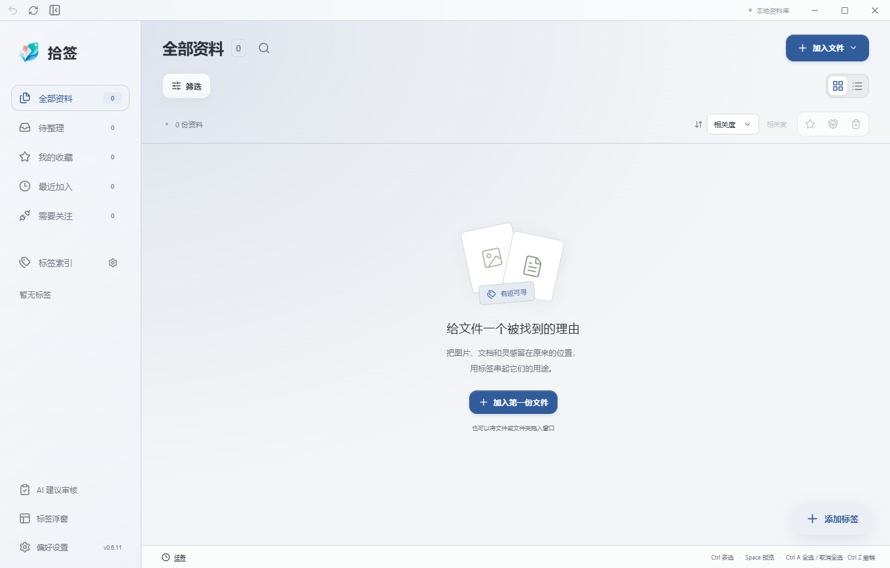

<div align="center">
  
  <h1>Tagrove · 拾签</h1>
  <p><strong>顺手贴上标签，随时找回资料。</strong></p>
  <p>为本地文件、图片与网页建立自己的资料库。</p>
  <p>
    
    
    
    
  </p>
  <p>
    <a href="docs/user-manual-v0.6.11.zh-CN.md">中文使用说明</a> ·
    <a href="docs/user-manual-v0.6.11.en.md">English guide</a> ·
    <a href="browser-extension/README.md">浏览器扩展</a> ·
    <a href="docs/post-acceptance-plan-2026-10-18.zh-CN.md">后续计划</a>
  </p>
</div>

---

文件留在熟悉的位置，通过多个标签、备注、收藏与搜索重新建立联系。需要整理时，打开标签浮窗，把标签拖到文件上；需要找回时，从工作台直接阅读内容或打开原件。

当前源码为 **v0.6.11**，本轮交付标识为 **v0.6.11-brand.1**。桌面、安装包与 Chrome 扩展统一使用透明 Tagrove Logo；新用户默认主题为 **群青（Ultramarine）**，已有用户保存的主题选择会保留。



## 资料整理，保持顺手

| 能力 | 使用方式 |
| --- | --- |
| 本地文件与图片 | 瀑布流和列表浏览，可调列数、侧栏与详情宽度；原文件通常保留原路径 |
| 标签与分类 | 多标签、分类、重命名、颜色和批量标注；文件夹标签与普通标签分开管理 |
| 标签浮窗 | 全部普通标签、分类展开、拖动排序与跨分类整理、拖放标注、仅保留标题栏的收起状态 |
| 统一搜索 | 文件名、标签、备注与已提取正文；可选语义检索补充结果，支持保存筛选集合 |
| 阅读与预览 | 图片缩放、PDF 连续阅读与文字层、Markdown 阅读/编辑、HTML 静态/源码、DOCX/XLSX 内容预览 |
| Office 原排版 | 优先检测本机 Microsoft Office / WPS 的可用自动化能力，按需生成原排版预览；受安装版本与接口支持影响 |
| 网页采集 | Chrome 扩展保存链接、摘录与图片，选择标签、离线队列、失败诊断；详情支持在线网页与阅读副本 |
| AI 标签建议 | 可选自动分析；未确认建议独立审核，手动选择标签的采集不再自动识别 |
| 交接与备份 | 导出包含原件的资料包，导入时按原父文件夹整理；标注备份用于恢复资料库信息 |
| 个性化 | 中英文界面、浅色/深色、12 种主题色、字号调整与可折叠偏好设置 |

**AI 和语义检索都需要用户自行配置兼容服务。** 不启用时仍可手工标注、本地搜索和预览。AI 标注使用对话/视觉模型；语义检索需要提供 embeddings 接口的向量模型，两者不能直接混用。

## 开始使用

[GitHub Releases](https://github.com/SACO1F/Tagrove/releases) 中提供已公开发布的下载。请核对发布页版本；仓库源码可能领先于公开安装包，不能以此 README 推断旧安装包包含当前功能。

本轮本地交付位于 `releases/v0.6.11-brand.1/`：

- `Shiqian-v0.6.11-brand.1-Windows-x64.exe`：直接运行程序。
- `Shiqian-v0.6.11-brand.1-Windows-x64-setup.exe`：安装包。
- `Shiqian-v0.6.11-brand.1-Chrome-extension.zip`：配套 Chrome 扩展。
- `SHA256SUMS.txt`：交付文件校验值。

升级前导出标注备份，重要原件另行备份；退出旧实例，再安装或运行新版。不要让两个版本同时写入同一个资料库。独立 EXE 沿用当前 Windows 用户的应用数据，**只发送 EXE 不会一并发送文件与标签**。

给同事交接资料时，在工作台选中文件并导出资料包；同事安装后导入该包。标注备份不包含原文件，不能替代资料包。

Chrome 扩展目前通过开发者模式加载：解压扩展，在 `chrome://extensions` 加载含 `manifest.json` 的目录，再到桌面偏好设置连接浏览器。升级时替换原目录并重新加载，保留扩展 ID 和队列；详见[扩展说明](browser-extension/README.md)。

## 在自己的电脑上开发

环境：Windows x64、Node.js 22+、Rust 1.90+、Microsoft C++ Build Tools 与 WebView2。依赖锁文件随仓库提供。

```powershell
npm ci
npm run build
npm run desktop
```

构建安装包和运行核心回归：

```powershell
npm run package
npm run test:auto-tags
```

前端采用 React、TypeScript 与 Vite；桌面采用 Tauri 2、Rust 和 SQLite。PDF 预览资源从已安装依赖复制，`npm run build` 会自动准备，无需提交生成目录。

```text
src/                    工作台、浮窗、搜索、阅读与设置界面
src-tauri/src/          资料库、文件处理、Office 引擎、采集与本机桥接
browser-extension/      Chrome 扩展与采集队列
public/icon.png         透明 Logo 源文件
src-tauri/icons/        原生平台图标与安装器图标
scripts/                构建、检查与交付脚本
docs/                   使用说明、版本说明与后续计划
```

## 数据和预览的边界

资料库默认在本机保存。开启 AI 或语义服务后，分析内容会发送至用户配置的服务，可能产生费用。在线网页通过独立 WebView2 打开，不共享 Chrome 登录状态；阅读副本是采集内容，不能保证还原完整网站。

Office 原排版依赖本机可用引擎，无法保证每种 WPS/Office 版本都能自动化；内容预览也不等同于完整 Office 编辑器。资料包用于跨电脑交接，活跃 SQLite 数据库不应直接放入网盘并发同步。

支持的具体格式、限制、快捷键和排障步骤见[使用说明](docs/user-manual-v0.6.11.zh-CN.md)。本轮验证见[品牌与默认主题更新](docs/brand-update-2026-10-19.zh-CN.md)，第三方依赖见[THIRD_PARTY_NOTICES](THIRD_PARTY_NOTICES.md)。
